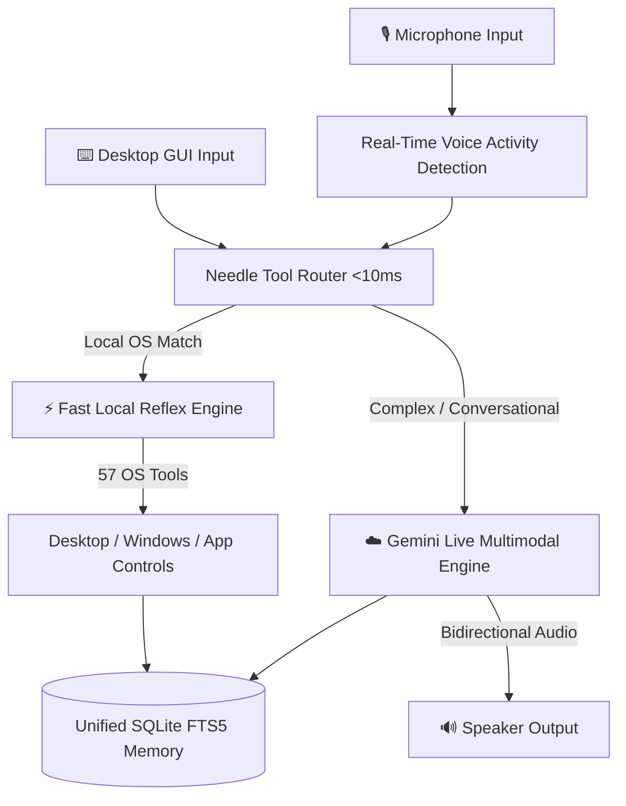

# 🏗️ J.A.R.V.I.S. Technical Architecture

J.A.R.V.I.S. (SudhirDevOps1 AI Assistant) operates on a hybrid dual-engine architecture designed for **sub-10ms local operating system actions** alongside **ultra-responsive multimodal voice interaction** via Google Gemini Live.

---

## 1. High-Level Architecture Diagram

---

## 2. Core Pillars

### ⚡ Layer 1: Fast Local OS Reflex (<10ms)
- **Engine:** `NeedleToolRouter` in `core/edge_router.py`.
- **Purpose:** Executes deterministic system operations locally without round-trips to the cloud and with **0 token consumption**.
- **Capabilities:**
  - App launching & closing (`open_app.py`) with process table verification.
  - Media & sound control (`volume_up`, `mute`, `play`, `pause`).
  - Screen operations (`screenshot`, `minimise`, `maximize`).
  - System diagnostics (`network_diagnostics`, `cpu`, `battery`, `ram`).
  - Local multi-turn context buffer (`core/context_buffer.py`) with Hinglish anaphora resolution.

### ☁️ Layer 2: Cloud Multimodal Engine (Gemini Live)
- **Engine:** Real-time bidirectional WebSocket streaming using `google.genai`.
- **Latency:** ~500ms end-to-end voice loop.
- **Failover:** Multi-key pool rotation (3-4 keys) in `memory/config_manager.py` that automatically rotates keys upon encountering HTTP 429 quota exhaustion.

### 🧠 Layer 3: Memory & State Persistence
- **FTS5 Full-Text Search:** `config/jarvis_memory.db` for instant recall of user preferences, history, and system entities.
- **TinyDB Memory Store:** `memory/tinydb_store.json` for fast key-value metadata.
- **Zero-Leak Protection:** Strict `.gitignore` boundaries ensuring local memories, notes, and credentials never leave the host machine.
